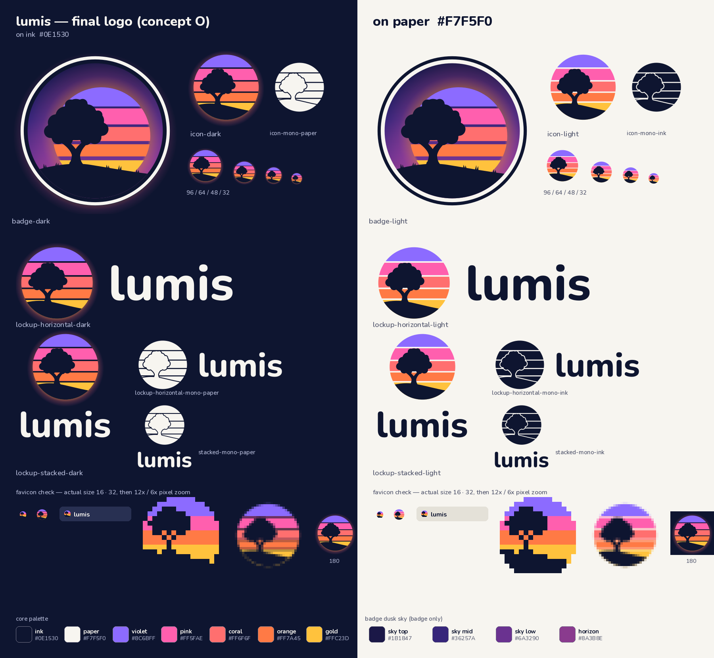

# Lumis brand



Lumis is a syntax highlighter powered by Tree-sitter and Neovim themes. The mark is a friendly, lumpy oak with a short forked trunk. It stands on a small hill, set off-center to the left, in front of a striped retro sunset sun inside a circle. The tree nods to Tree-sitter, and the stripes are highlighted lines of code. The feel is warm, nostalgic and dusky: not game-like and not cute.

All paths below are relative to this folder (`assets/brand/`).

## Palette

| Role | Name | Hex |
|---|---|---|
| Silhouette, text, dark background | ink | `#0E1530` |
| Light background, text on dark | paper | `#F7F5F0` |
| Sun band 1 (top) | violet | `#8C6BFF` |
| Sun band 2 | pink | `#FF5FAE` |
| Sun band 3 | coral | `#FF6F6F` |
| Sun band 4 | orange | `#FF7A45` |
| Sun band 5 (horizon) | gold | `#FFC23D` |

- **Badge only:**
  - Dusk sky gradient, top to bottom: `#1B1847` → `#36257A` → `#6A3290` → `#8A3B8E`.
  - Sun glow: `#FF8A4C`.
- **Dark-background halo:** a radial gradient. It runs from `#FF8A4C` at 55% opacity, to `#FF6F6F` at 22%, to `#FF5FAE` at 0%.
- **Tagline text:** `#AEB3CF` on ink and `#545A78` on paper.
- **Color rules:**
  - No green anywhere: the tree and hill are always pure ink.
  - No cyan or light-blue bands, in the sun or the sky.
  - The bands always run violet at the top down to gold at the bottom.

## Type

- **Wordmark:** lowercase `lumis` in **Nunito ExtraBold (800)**, kerned with the font's own kerning.
  - Use ink on light backgrounds and paper on dark ones.
  - Never set it in sun colors.
- **Tagline in the banners and social preview:** Nunito SemiBold (600).
- **Outlined text:** all text in these files is converted to vector paths, so no font needs to be installed or bundled.
- **Suggested companion fonts:**
  - Nunito 400–700 for UI and docs headings
  - Inter or the system UI font for body text
  - JetBrains Mono or another monospace font for code

**Font attribution:** Nunito is © The Nunito Project Authors (https://github.com/googlefonts/nunito). It is licensed under the SIL Open Font License, Version 1.1 (https://openfontlicense.org). The wordmark and tagline are outlines derived from Nunito, and the font files themselves are not distributed here.

## Logo versions

- **Icon** (`logo/icon-*.svg`): the primary mark. It is the circle with the stripes, the oak and the hill.
- **Lockups** (`logo/lockup-horizontal-*.svg`, `logo/lockup-stacked-*.svg`): the icon plus the wordmark.
  - Horizontal: the wordmark is 0.50 × the icon diameter D, with a gap of 0.26 × D.
  - Stacked: the wordmark is 0.40 × D, with a gap of 0.17 × D, centered.
- **Badge** (`logo/badge-*.svg`): the hero illustration. It shows the oak on its hill, backlit by the striped sun, with a dusk sky, a soft sun glow, grass tufts and a ring frame.
  - It deliberately has no fireflies or stars.
  - Use it for heroes, stickers and social cards. Don't use it at small sizes.
- **Mono** (`*-mono-ink`, `*-mono-paper`): single-color versions.
  - The stripes are knocked out around a solid tree.
  - Use them for print, embossing and one-color contexts.
- **Favicon** (`favicon/favicon.svg`): hand-placed pixel art on a 16 × 16 grid.
  - It has four bands with no gaps, plus a simplified tree and hill.
  - `favicon-32.png` is rendered from the full icon instead.
  - `favicon-180.png` and `favicon-512.png` are app icons, rendered from `favicon/app-icon.svg` (the haloed icon on an ink square).
- **README banners** (`banners/readme-banner-{dark,light}`): 1280 × 320. Each has the horizontal lockup and the tagline.
- **Social preview** (`social/social-preview`): 1280 × 640, on ink. All content sits inside a 40 px safe border.

## Dark backgrounds

On ink or any dark background, use the `-dark` files. They place a warm radial halo behind the circle so the sun looks backlit. They also have an ink backing disc, so the gaps between the stripes stay crisp. On light backgrounds, use the `-light` files, which have no halo. The halo is built from gradients only, with no blur filters, so it renders the same everywhere.

## Usage rules

- **Clear space:** at least ¼ of the icon diameter on every side. The halo may extend into the clear space.
- **Minimum sizes:**
  - Icon: 24 px. Below that, use the favicon.
  - Horizontal lockup: 100 px wide.
  - Stacked lockup: 64 px wide.
  - Badge: 160 px.
- **Don'ts:**
  - Don't add green, or cyan or blue bands.
  - Don't recolor, reorder or add bands.
  - Don't center the tree. It stays off-center to the left.
  - Don't make the tree round and lollipop-like (it starts to look like a joystick). Keep the lumpy canopy and the forked trunk.
  - Don't add strokes, drop shadows, bevels or blur.
  - Don't put the light icon on a dark background without its halo.
  - Don't stretch, rotate or crop the circle.
  - Don't set the wordmark in another font or in capitals.
  - Don't use the badge below 160 px or as a favicon.

## Files

| Path | Use |
|---|---|
| `logo/icon-{dark,light}.svg` | Icon. The dark version has the halo. |
| `logo/icon-mono-{ink,paper}.svg` | Single-color icon. |
| `logo/lockup-horizontal-{dark,light,mono-ink,mono-paper}.svg` | Icon plus wordmark, side by side. |
| `logo/lockup-stacked-{dark,light,mono-ink,mono-paper}.svg` | Icon above the wordmark. |
| `logo/badge-{dark,light}.svg` | Hero badge. |
| `png/*.png`, `png/*@2x.png` | Color PNGs at 1x and 2x. The 1x widths are: badge 512, icon 256, horizontal lockup 640, stacked lockup 360. |
| `favicon/favicon.svg`, `favicon/favicon-{16,32}.png` | Browser favicons. |
| `favicon/favicon-180.png`, `favicon/favicon-512.png`, `favicon/app-icon.svg` | Apple touch icon and app icon, plus their source. |
| `banners/readme-banner-{dark,light}.{svg,png}`, `@2x.png` | README header banners. |
| `social/social-preview.{svg,png}` | GitHub social preview, 1280 × 640. |
| `overview.png` | Board showing every version on dark and light. |

**Suggested HTML for the website (copy the favicon files to the site root):**

```html
<link rel="icon" href="/favicon.svg" type="image/svg+xml">
<link rel="icon" href="/favicon-32.png" sizes="32x32" type="image/png">
<link rel="apple-touch-icon" href="/favicon-180.png">
```
